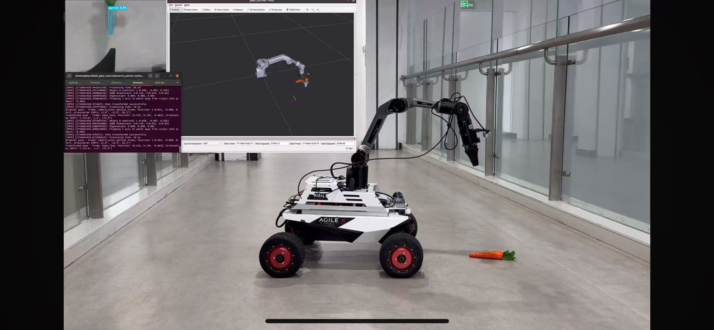
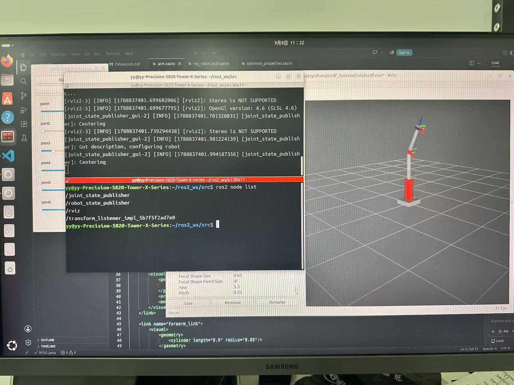
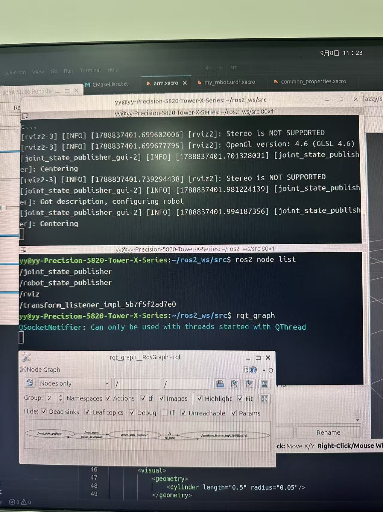
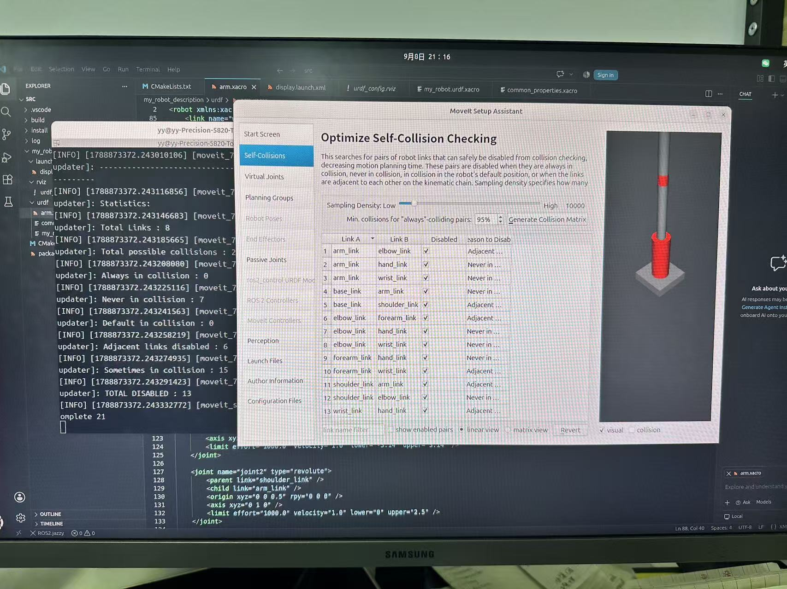
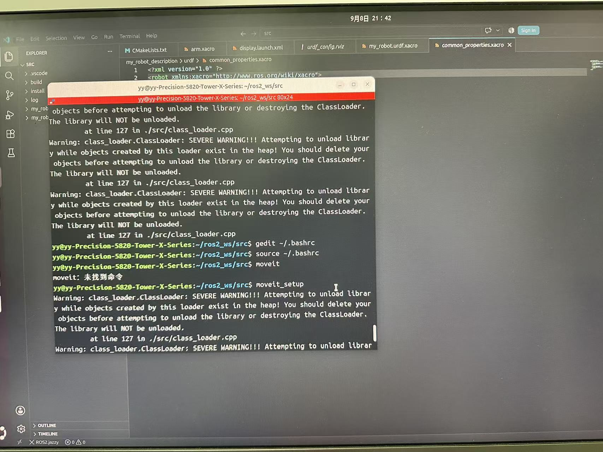

# Piper ROS 2 Workspace

Robot description, MoveIt configuration, and control interfaces for a Piper robotic arm.

This workspace brings together robot modeling, visualization, motion-planning configuration, camera integration, and command interfaces. It includes launch files for the arm, joystick input, and an ArUco pose-estimation package.

## Hardware and development



*Robot platform shown alongside camera and RViz views. The photograph provides hardware context; the packages in this repository focus on the arm workspace.*

## Workspace packages

| Package or directory | Purpose |
| --- | --- |
| `my_robot_description` | Robot description, Xacro files, meshes, and visualization configuration |
| `my_robot_moveit_config` | MoveIt planning and launch configuration |
| `my_robot_bringup` | Launch files for bringing up the robot |
| `my_robot_commander_cpp` | C++ command node and MoveIt test executable |
| `my_robot_interfaces` | Custom command messages |
| `piper` | Piper integration package |
| `piper_msgs` | Piper message definitions |
| `ps_controller` | Controller-related code |
| `ros2-aruco-pose-estimation` | ArUco detection and pose-estimation packages |

## Development gallery

### Robot model visualization



*Inspecting the robot model in RViz alongside joint controls and the active ROS nodes.*

### ROS node inspection



*Using `ros2 node list` and `rqt_graph` to inspect the visualization session, including the joint-state and robot-state publishers.*

### MoveIt configuration



*Reviewing link pairs in the self-collision configuration during robot setup.*

<details>
<summary>Environment troubleshooting</summary>



This development record captures command lookup and class-loader warnings encountered during setup. It documents a troubleshooting session rather than a successful motion-execution result.

</details>

## Environment

The development photographs show a Linux desktop with ROS 2 Jazzy. Running the workspace requires a compatible ROS 2 installation and the dependencies of the selected packages, including MoveIt, RViz, and the relevant robot driver. The camera commands below additionally require `realsense2_camera`, and joystick input requires `joy`.

Run the following examples from the workspace root after building the packages. Source the ROS 2 environment and `install/setup.bash` in each terminal that uses the workspace. Replace machine-specific paths and device settings with those for your installation.

The commands below retain the original operating notes. They are grouped by task and are not intended to be executed as one continuous script. Hardware launch files and command publishers may enable or move the arm; use the visualization workflow first and check the physical workspace before issuing motion commands.

## Robot visualization

### Display the Xacro model in RViz

The original command uses an absolute path. Replace `/home/hanks/ros2_ws` with your workspace location.

```bash
ros2 launch urdf_tutorial display.launch.py model:=/home/hanks/ros2_ws/src/my_robot_description/urdf/my_robot.urdf.xacro
```

### Use the visualization launch file

```bash
ros2 launch my_robot_description display.launch.xml
```

## MoveIt and robot bringup

### Piper launch entry

```bash
ros2 launch my_robot_bringup start_piper.launch.xml
```

### MoveIt demo

```bash
ros2 launch my_robot_moveit_config demo.launch.py
```

The original notes also list the following bringup command alongside the MoveIt demo. Select the launch combination appropriate to your setup rather than launching duplicate instances.

```bash
ros2 launch my_robot_bringup start_piper.launch.xml
```

### Arm startup and MoveIt test

```bash
source install/setup.bash
bash can_activate.sh can0 1000000
ros2 launch my_robot_bringup my_robot.launch.xml
```

With bringup running, use another sourced terminal for the test executable:

```bash
ros2 run my_robot_commander_cpp test_moveit
```

### Disable the arm

```bash
ros2 topic pub /enable_flag std_msgs/msg/Bool data:\ false\ 
```

## Depth camera

Choose one camera startup method for the required configuration.

### Start the camera node

```bash
ros2 run realsense2_camera realsense2_camera_node
```

Alternatively, start with color disabled and spatial and temporal filtering enabled:

```bash
ros2 run realsense2_camera realsense2_camera_node --ros-args -p enable_color:=false -p spatial_filter.enable:=true -p temporal_filter.enable:=true
```

### Start with a launch file

```bash
ros2 launch realsense2_camera rs_launch.py
```

Or request the depth profile and point-cloud output recorded in the original notes:

```bash
ros2 launch realsense2_camera rs_launch.py depth_module.depth_profile:=1280x720x30 pointcloud.enable:=true
```

## Joystick and command node

Start joystick input:

```bash
ros2 run joy joy_node
```

In another sourced terminal, start the command node:

```bash
ros2 run my_robot_commander_cpp commander
```

## Command examples

These examples require the corresponding subscribers and robot configuration. Check the intended pose and joint limits before sending a command to hardware.

### Open the gripper

```bash
ros2 topic pub -1 /open_gripper example_interfaces/msg/Bool "{data: true}"
```

### Send a joint command

```bash
ros2 topic pub -1 /joint_command example_interfaces/msg/Float64MultiArray "{data: [0, 0, 0, 0, 0, 0]}"
```

### Send a pose command using a Cartesian path

```bash
ros2 topic pub -1 /pose_command my_robot_interfaces/msg/PoseCommand "{x: 0.3, y: 0.0, z: 0.2, roll: 0.0, pitch: 1.5708, yaw: 0.0, cartesian_path: true}"
```

### Send a pose command without a Cartesian path

```bash
ros2 topic pub -1 /pose_command my_robot_interfaces/msg/PoseCommand "{x: 0.2, y: 0.0, z: 0.2, roll: 0.0, pitch: 1.5708, yaw: 0.0, cartesian_path: false}"
```

## Repository layout

```text
piper-ros2-workspace/
├── src/                    # ROS 2 packages
├── assets/                 # Development photographs
├── can_activate.sh         # CAN activation helper
├── can_config.sh           # CAN configuration helper
├── find_all_can_port.sh    # CAN port discovery helper
├── start_piper.sh          # Startup helper
└── README.MD
```

Build output (`build/`, `install/`, and `log/`) and editor caches are not source files and should remain outside version control. Package-level documentation, author credits, and license files remain applicable to their respective components.
